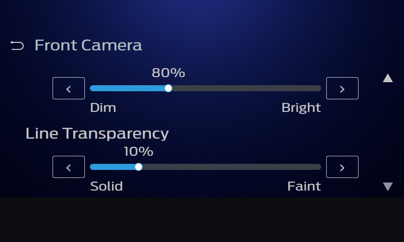

# Front Tire Guides

Howdy all,

The 2025 Bronco Sport got Trail View: tire guides on the front camera that show where your front tires are headed as
you turn the wheel. The earlier trucks didn't. This mod adds them to the front camera of a 2021+ Bronco Sport with
SYNC 3: two tracks of tread blocks that follow the steering, including the bit hidden under the bumper (in orange).
They work in both the normal front view and the 180 degree split view.

## What you need

- A Bronco Sport with the factory front camera and SYNC 3 on build **3.4.23188** (the installer refuses any other).
- The F-Mods jailbreak with **FMods Tools 2.8 or newer**.
- A FAT32 USB stick.

## Install

1. Grab the zip from this repository's [Releases](https://github.com/Trist0ne/front-tire-guides/releases) page (or
   build it yourself, below). Copy `DONTINDX.MSA` and the `SyncMyMod` folder to the top of an empty FAT32 stick. One
   mod per stick, since every F-Mods mod uses the same `SyncMyMod` folder name.
2. Truck PARKED, engine running. Plug the stick into SYNC and wait for "installed" on the screen. Don't switch off or
   pull the stick before that.
3. Pull the stick. SYNC restarts and you're done.

To remove it, same deal with the uninstall zip. SYNC's files are put back exactly how they were. (Building it
yourself: `./build.sh --uninstall`, or set `UNINSTALL=1` in `SyncMyMod/install.conf`.)

## Using it

- **In the camera view:** tap the menu button at the top left of the camera picture; there's a Tire Guides button on
  the front views. Lit means on.
- **Settings > Vehicle > Driver Assistance > Front Camera:**
  - *Tire Guides*: the same on / off.
  - *Lift Offset*: how much taller than stock your truck sits, from Stock to +4 inches in quarter-inch steps.
  - *Line Brightness*: from light grey (70%) to full white (100%); 95% to start.
  - *Line Transparency*: how much of the ground shows through the lines, from solid (0%) to 50%; 15% to start.

The guides show up a few seconds after SYNC starts. For the first minute or so SYNC is busy launching everything else,
so they can hitch a little; after that they track the wheel smoothly.

## Lift Offset

The guides are drawn from a measurement of the camera: its height, tilt and lens. It was taken on my First Edition
(1.75 inch lift, 235/65R17s), and the math works out the rest for any other height. All you need to do is tell it how
much taller than stock your truck sits: set Lift Offset to your lift, from Stock to +4 inches in quarter-inch steps.
Stock truck? Leave it on Stock.

## If something goes wrong

- **Turn them off:** Tire Guides off (camera view or settings page) and nothing gets drawn.
- **Remove it:** the uninstall stick puts Ford's files back exactly how they were.

## See also

[Enhanced Camera Control](https://github.com/Trist0ne/enhanced-camera-control): the front camera on and off by its
button only, up to about 19 mph. The two mods are independent and share one "Front Camera" settings page.

## What it changes on SYNC

Everything below is removed by the uninstaller, and Ford's files are restored byte for byte.

| What | Where |
|---|---|
| The program | `/fs/images/fmods_apps_data/FrontTireGuides` |
| The screen layer | `/fs/mp/fordhmi/qml/hmirvc/frontguides` |
| Calibration, lift, the line settings, the switch | `/fs/rwdata/frontguides` |
| One line in SYNC's startup script, after the line that launches SYNC's services | `/fs/mp/scripts/startup_gf.sh` |
| A layer in the camera popup; a button in the camera view row | `RVCPopup.qml`, `CameraViewButtons.qml` |
| Its rows on the camera settings page; a "Front Camera" entry in Driver Assistance | `RVCSettings.qml`, `DriverAssistSettingsMenu.qml` |

A Ford file is only changed if it is Ford's stock file for this build; otherwise the install stops (or, for the
settings page, carries on without it). The "Front Camera" entry is shared with Enhanced Camera Control: either mod can
be installed or removed without the other, and the entry goes with the last of them.

It sends nothing to the truck and reads no module. Its only request is a subscription to SYNC's own copy of the
steering angle and of the camera view.

## How it works

- **`program/guidesd.c`** runs on SYNC. It takes the steering angle from SYNC's vehicle-data service (about ten values
  a second, not evenly spaced), smooths it, and writes what the screen layer needs 30 times a second.
- **`screen/GuidesOverlay.qml`** draws the guides on SYNC's graphics chip: a vertex shader carries a strip of ground
  along the steering arc and through the camera model, and a fragment shader colours it. Per frame the script hands
  over one number.
- **The picture channel.** SYNC's screen software is one Qt 5.6 script engine shared by all of Ford's screens. It
  freezes the whole screen for about a tenth of a second whenever it clears away objects that scripts have dropped,
  and reading a file through a request makes a lot of them. So the steering is passed as the *sizes* of tiny empty
  image files, which reach a script as plain numbers. See the comments in `guidesd.c` and `GuidesLayer.qml`.
- **`calibration/tirepath.js`** and **`program/tirepath.c`** hold the same camera and tire-path arithmetic, in
  JavaScript for the calibration tool and in C for SYNC.

## Building

`./package.sh` packs the install and uninstall sticks as zip files for a release. `./build.sh [out dir]` builds the stick folder. The program is cross-compiled for QNX 6.5 (armle-v7) in a Docker image
holding a QNX 6.5 gcc (`QNX_IMAGE`, `QNX_CC`).

No Ford software is included here.

## Support

This is free. If it saved you a bumper (or just some annoyance) and you want to buy me a coffee, there's a tip jar at
[ko-fi.com/trist0n](https://ko-fi.com/trist0n). Totally optional, and thanks either way!

## Disclaimer

An independent hobby project. It is not made, endorsed or supported by Ford Motor Company or by F-Mods, and it
contains none of their software. It changes how your truck's infotainment system behaves: you install and use it at
your own risk, and it may affect your warranty. The camera is an aid; look outside before you move.

## License

MIT: see [LICENSE](LICENSE).
